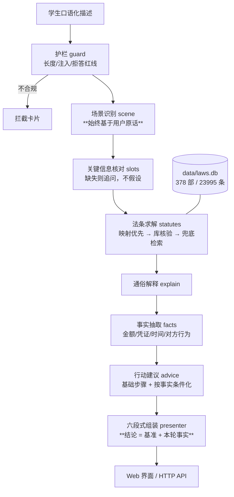

# 大学生法律常识问答 Agent

面向在校大学生的法律常识问答助手：输入一段口语化的处境描述，输出**结论 / 适用法条 / 通俗解释 / 行动建议 / 需要补充的信息 / 免责声明** 六段式回答。

**设计立场**：这不是一个"让大模型自由发挥"的问答机器人。法条是最不能容忍编造的领域，所以本系统把
**法条原文的获取与核验**做成一条确定性流水线——**默认不调用任何大模型**，也不依赖任何外部 API。

---

## 一、核心特性

| 特性 | 说明 |
|---|---|
| **零编造** | 法条原文只从本地 `data/laws.db` 逐字取出；输出中的每条引用都会在评测里回库核验 |
| **完全离线** | 知识库随项目分发，无需 API key、无需联网；LLM 润色为可选且默认关闭 |
| **精准优先** | 口语场景走人工核验过的「场景→法条」映射（35 条），不依赖裸检索 |
| **回答随问题变** | 路由由**用户原话**决定；结论与建议由**本轮事实**驱动——不同问题不会拿到同一段模板 |
| **诚实边界** | 关键信息缺失主动追问；依据不在库内（如司法解释）时明说"需另行核实"，不外推 |
| **可溯源** | 每条法条随结果返回 `article_id`（库主键），可精确回溯到库内那一行 |
| **有界可控** | 固定流水线，无自主循环；每步可断言、可重放、可观测 |

## 二、架构



**为什么不用自主 Agent**：本任务的控制流是确定的（分类 → 检索 → 模板化表达），引入 Planner/Reflection
只会带来不确定性、成本和运维负担。LLM 在本系统里至多是"文字润色工"，与法条内容无关。

**为什么路由必须由输入决定**：`sceneId` 只是界面快捷入口传来的**兜底提示**——仅当用户原话
识别不出领域时才生效。若让它反过来覆盖用户输入，界面上一旦残留选择，之后所有问题都会被
强行归到同一个场景，回答完全一样（详见第九节）。

## 三、目录结构

```
大学生法律常识问答/
├── server.py                     # 单端口 HTTP 服务（仅标准库 http.server）
├── requirements.txt              # jieba / rank-bm25（纯 Python）
├── legal_agent/
│   ├── pipeline.py               # 编排 + trace + 阶段回调
│   ├── guard.py                  # 输入校验 / 注入拦截 / 拒答红线
│   ├── scene.py  slots.py        # 场景识别 / 关键信息核对
│   ├── statutes.py  explain.py  advice.py   # 法条求解 / 通俗解释 / 行动建议
│   ├── facts.py                  # 本轮事实抽取（金额/凭证/时间/对方行为）
│   ├── presenter.py              # 六段式输出 + 免责声明 + 边界提示
│   ├── obs.py                    # trace / 埋点 / 脱敏 / 指标
│   ├── llm.py                    # 可选 LLM 润色（默认关闭）
│   ├── maps.py                   # 领域数据装载
│   ├── lawkb/                    # vendor 自 china-law-mcp（MIT），未改检索逻辑
│   └── data/                     # scene_map / explain_map / advice_map / slot_hints
├── data/
│   ├── laws.db                   # 法条库（15.8 MB，含查询索引；运行时唯一必需的数据）
│   ├── SOURCES.md                # 数据来源与边界说明
│   └── external/                 # 构建期克隆仓库（部署时排除）
├── public/                       # 前端（原生 JS，无构建步骤）
├── tests/                        # cases.jsonl / run_eval.py / smoke_http.py / test_variation.py
├── scripts/                      # verify_maps.py / audit_kb.py / optimize_db.py
└── docs/                         # SYSTEM_PROMPT.md / USER_GUIDE.md
```

## 四、快速开始

```bash
# 1) 依赖（纯 Python，无原生编译）
python -m venv .venv
.venv/Scripts/python -m pip install -r requirements.txt      # Windows
# .venv/bin/python -m pip install -r requirements.txt        # macOS / Linux

# 2) 启动（监听 PORT，绑定 0.0.0.0）
PORT=3000 python server.py
# 浏览器打开 http://127.0.0.1:3000
```

## 五、配置项（环境变量）

| 变量 | 默认 | 说明 |
|---|---|---|
| `PORT` | `3000` | 监听端口（发布沙箱会注入） |
| `HOST` | `0.0.0.0` | 绑定地址（沙箱要求 `0.0.0.0`） |
| `MAX_BODY_BYTES` | `262144` | 请求体上限 |
| `STREAM_DELAY_MS` | `14` | 流式逐行间隔（毫秒），设 `0` 关闭节流 |
| `LLM_API_KEY` | 空 | 可选。设置后启用"通俗解释"润色 |
| `LLM_BASE_URL` | 空 | 可选。OpenAI 兼容端点 |
| `LLM_MODEL` | `gpt-4o-mini` | 可选。润色用模型 |

## 六、接口

| 方法 | 路径 | 说明 |
|---|---|---|
| GET | `/` | 问答界面 |
| GET | `/api/health` | 健康检查（知识库规模、BM25 状态、指标） |
| GET | `/api/scenes` | 五个专项领域（含示例问法） |
| POST | `/api/ask` | 非流式问答 |
| POST | `/api/ask/stream` | 流式问答（SSE：`stage*` → `text*` → `result` → `done`） |

请求体：`{"message": "...", "history": ["..."], "sceneId": "rental"}`（后两项可选）。

`sceneId` 的语义是**兜底提示**：仅当 `message` 识别不出领域时才会采用；用户原话始终优先。
界面上的领域快捷按钮发出的 `sceneId` 是一次性的，发送后即清空。

**幂等性**：整条链路只读（SQLite 只读查询 + 纯函数），同一输入恒定输出，天然幂等。
**超时与重试**：唯一外部调用是可选的 LLM，已设 12s 超时 + 1 次重试，失败静默回退模板。

## 七、测试与基线

```bash
python scripts/verify_maps.py     # 五领域法条核验（存在性 + 原文关键词）
python scripts/audit_kb.py        # 语料一致性审计
python tests/run_eval.py          # 评测集
python tests/smoke_http.py        # 端到端 HTTP + SSE 冒烟（自起自停服务）
python tests/test_variation.py    # 回答隔离性回归（不同问题必须得到不同回答）
```

当前基线：

| 项目 | 结果 |
|---|---|
| 法条核验 | **35 / 35** 通过 |
| 评测集 | **23 / 23**（正常 5 / 边界 11 / 对抗 7） |
| 回答隔离性 | **14 / 14**（不同问题→不同回答、残留提示不覆盖输入、同领域不同事实结论不同） |
| 端到端冒烟 | **16 / 16** |
| 响应延迟 | 典型 **≈ 40 ms**；兜底检索路径约 **250 ms**；P95 **290 ms** |
| 零编造断言 | 输出中每条引用回库核验 + 原文逐字比对，全部通过 |

评测集覆盖：租房押金 / 兼职欠薪 / 网购退货 / 校园贷 / 论文抄袭（5 组核心）
＋ 关键信息缺失追问、超长输入、空输入、招呼语、领域快捷入口、超出专项范围兜底（边界）
＋ 提示注入、伪造证据、教唆逃债、**要求不存在的法条**、诱导绝对判断、索取他人隐私、索要文书模板（对抗）。

## 八、部署

本服务符合"单端口 HTTP 服务"形态：监听 `PORT`、绑定 `0.0.0.0`、无外部数据库依赖（SQLite 随包）。

- 部署前请确认 `data/laws.db` 已就位；
- 部署包应**排除** `data/external/`（构建期克隆仓库）与 `.venv/`（见 `.gitignore`）；
- 运行时体积约 **16 MB**（主要是 15.8 MB 的法条库）；`data/bm25.pkl`（11 MB）可再生成，已排除。

**性能**：`scripts/optimize_db.py` 给 `laws.db` 补了 `(law_name, article_no_arabic)` 复合索引（幂等），
单次法条直查从约 34 ms 降到 0.1 ms 以内——此前一次回答要直查 6 条法条，占掉约 200 ms。

**回滚**：本服务无状态、无外部副作用。
1) 若为新版本导致异常，重新部署上一版本源码即可（同一链接、内容覆盖）；
2) 若知识库文件需回退，恢复上一次的 `data/laws.db` 并重启；
3) 由于结果完全由输入决定，回滚后可用同一组评测用例快速确认行为是否恢复。

## 九、已知边界

1. **不含司法解释**——"利率司法保护上限"等依据在司法解释中的标准，系统只提示"需另行核实"。
2. **42 处语料重复条目**（集中在《刑法》修正案相关条目）——映射法条 0 条落在此集合内；
   兜底检索结果一律标注"仅供参考"。
3. **事实抽取只做摘录**——`facts.py` 从原话里摘金额/凭证/时间等，抽不到就留空，不替用户补事实；
   因此它只会让回答更贴合，不会凭空生成情节。
4. 本系统**不构成法律意见**，不代替用户做决定。

详见 [`data/SOURCES.md`](data/SOURCES.md) 与 [`docs/SYSTEM_PROMPT.md`](docs/SYSTEM_PROMPT.md)。

## 十、许可与致谢

- 法条检索与引用核验能力来自 **china-law-mcp**（MIT），见 `LICENSE-china-law-mcp.txt`。
- 本项目的领域映射、话术与工程实现为原创。
